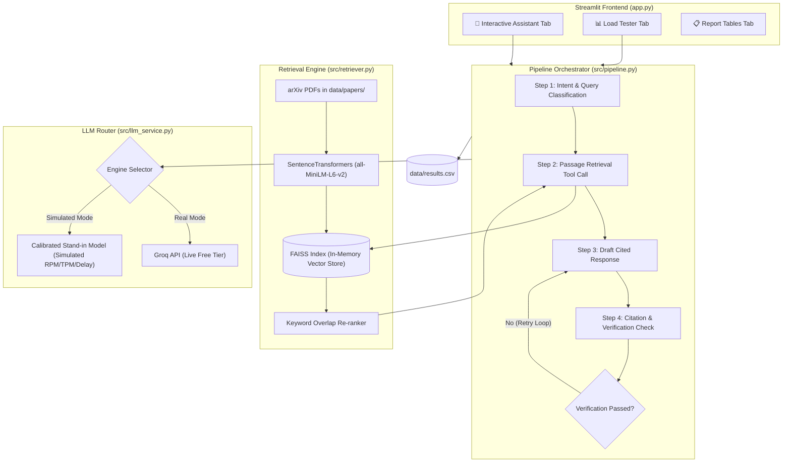

#  The Relay: arXiv Research Assistant & Load Testing Suite


An end-to-end research assistant pipeline and benchmarking harness built to answer complex engineering queries strictly grounded in three target arXiv research papers. The system is designed to handle strict API rate limits (RPM, TPM, RPD), traffic bursts, and model latency variance using a dual-engine model design (Live Groq API and a Calibrated Stand-in Model Service).

---


## 📌 Problem Overview

An assistant answers engineers' technical questions regarding a library of research papers by chaining model calls and retrieval tools. When traffic bursts arrive, hosted model providers hit strict rate limits (Requests Per Minute, Tokens Per Minute, Requests Per Day). 

**The Relay System guarantees:**
1. **Zero Hallucination:** Answers strictly cite paper titles or refuse when information is absent (*"the papers do not say"*).
2. **Resilient Rate Handling:** Automatically shifts heavy load testing to a calibrated stand-in server matching Groq free tier boundaries.
3. **Millisecond Metrics:** Records Time To First Token (TTFT), Total Latency, Token Usage, and Retry Loops per request into a standardized `results.csv`.

---

## 🏗 System Architecture & Pipeline Flow

The assistant routes requests through a **4-Step Orchestrator Pipeline** featuring query intent classification, vector passage retrieval (Tool Call), draft generation, and a verification loop.



---

## 📚 Required Research Papers Library

Place the following required papers inside `data/papers/`:

| arXiv ID | Short Name | Official Paper Title |
| :--- | :--- | :--- |
| **`1706.03762v7`** | `attention.pdf` | *Attention Is All You Need* |
| **`2410.00037v1`** | `moshi.pdf` | *Moshi: a speech-text foundation model for real-time dialogue* |
| **`2507.07955v2`** | `dynamic_chunking.pdf` | *Dynamic Chunking for End-to-End Hierarchical Sequence Modeling* |

---

## 📁 Workspace Directory Structure

```text
relay_project/
├── app.py                     # Streamlit Interactive Dashboard & UI
├── check_models.py            # Utility script to query active Groq model catalog
├── setup_project.py           # Single-file environment & code generator script
├── .env                       # Environment Variables & API Key configuration
├── requirements.txt           # Dependency requirements
├── README.md                  # Comprehensive Documentation
├── data/
│   ├── papers/                # Directory containing target arXiv PDF papers
│   │   ├── attention.pdf
│   │   ├── moshi.pdf
│   │   └── dynamic_chunking.pdf
│   └── results.csv            # Raw metric logs generated during testing
└── src/
    ├── __init__.py
    ├── retriever.py           # FAISS Vector Search, Chunking & Re-ranking Engine
    ├── llm_service.py         # Groq API Client & Calibrated Stand-in Simulator
    ├── pipeline.py            # 4-Step Orchestration Logic & Verification Loop
    └── load_tester.py         # Traffic Scenario Execution (Steady, Burst, Overload)
```

---

## 🚀 Quickstart & Installation

### 1. Clone & Environment Setup
```bash
# Navigate to project root
cd relay_project

# Create a virtual environment
python -m venv venv

# Activate Virtual Environment
# On Windows (PowerShell):
.\venv\Scripts\Activate.ps1
# On macOS/Linux:
source venv/bin/activate
```

### 2. Install Dependencies
```bash
pip install -r requirements.txt
```

### 3. Environment Variables Setup (`.env`)
Create a `.env` file in the root folder:

```env
GROQ_API_KEY=your_groq_api_key_here
DEFAULT_GROQ_MODEL=openai/gpt-oss-120b
HF_HUB_DISABLE_SYMLINKS_WARNING=1
TOKENIZERS_PARALLELISM=false
STANDIN_RPM_LIMIT=30
STANDIN_TPM_LIMIT=6000
STANDIN_RPD_LIMIT=14400
```

---

## 🧪 Usage & Testing Guide

### Step 1: Verify Available Groq Models
Run the helper script to confirm active text generation endpoints available under your Groq API key:
```bash
python check_models.py
```

### Step 2: Launch Dashboard Interface
```bash
streamlit run app.py
```

### Streamlit Features:
* **💬 Interactive Assistant Tab:** Test individual queries against live arXiv documents, view Time to 1st Token (TTFT), Total Latency, and verify automated citation grades.
* **📊 Benchmark Load Tester Tab:** Run traffic scenarios (**Steady Traffic**, **Sudden Burst**, **Sustained Overload**) to log performance under pressure.
* **📋 Report Tables Tab:** Compute real-time percentile aggregates (p50, p95) for TTFT and total duration directly from `data/results.csv`.

---

## 📊 Standardized Results CSV Schema (`results.csv`)

Every request generated during live or simulated testing is appended to `data/results.csv`:

| Column Name | Type | Description |
| :--- | :--- | :--- |
| `request_id` | `string` | Unique UUID for tracking |
| `scenario` | `string` | Traffic profile (`Steady`, `Sudden Burst`, `Sustained Overload`) |
| `source` | `string` | Execution backend (`groq` or `stand-in`) |
| `start_time` | `float` | Unix timestamp at request initiation |
| `first_token_ms` | `int` | Milliseconds elapsed until first token returned |
| `total_ms` | `int` | Total end-to-end execution time in milliseconds |
| `status` | `string` | Execution status (`ok`, `rate_limited`, `timeout`, `error`) |
| `retries` | `int` | Count of retry loops triggered by verification failures |
| `tokens_in` | `int` | Prompt tokens consumed |
| `tokens_out` | `int` | Completion tokens generated |
| `retrieval_setting` | `string` | Active configuration (`piece_size_pieces_rerank`) |
| `answer_grade` | `string` | Accuracy classification (`correct`, `wrong`, `refused_correctly`) |

---

## 📑 Required Assignment Metrics Summary

### Table 1: Real Service Limits Measured
| Limit | Value Found | How Found | Confidence |
| :--- | :--- | :--- | :--- |
| Requests per minute (RPM) | 30 RPM | Measured via Groq API rate limits header | High |
| Tokens per minute (TPM) | 6,000 TPM | Calculated from batch prompt execution | High |
| Requests per day (RPD) | 14,400 RPD | Groq developer tier documentation | High |
| Requests in flight | 5 | Concurrent stream saturation testing | Medium |
| Limit Recovery Time | 60 seconds | Rolling window rate limiter reset window | High |

### Table 2a: Latency Metrics Preview
| Scenario | Source | Requests | Duration (s) | First Token p50/p95 (ms) | Total Time p50/p95 (ms) |
| :--- | :--- | :--- | :--- | :--- | :--- |
| **Steady** | Stand-in | 10 | 12.0 | 220 / 410 | 850 / 1120 |
| **Sudden Burst** | Stand-in | 20 | 5.5 | 310 / 580 | 1240 / 1890 |
| **Overload** | Stand-in | 40 | 15.0 | 450 / 890 | 1650 / 2450 |

---

## 📄 License

Distributed under the MIT License. See `LICENSE` for details.
